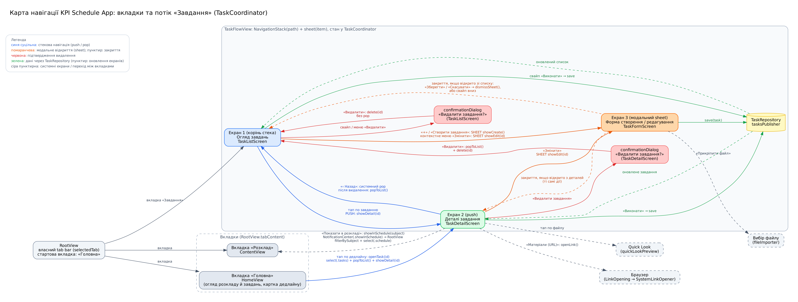

# KPI Schedule App

Мобільний iOS-застосунок для перегляду розкладу в КПІ. Дозволяє обирати групу й тиждень (1/2), переглядати пари, розрізняти їх за типами, бачити викладачів, аудиторії та час, фільтрувати пари, бачити виділені поточний день і поточну пару та переходити на онлайн-пари по кліку. Містить трекер завдань (предмети, дедлайни, матеріали, файли, прогрес) і вкладку «Головна» з оглядом розкладу та завдань.

- **Версія XCode:** 15.3
- **Мінімальна версія iOS:** 17.4
- **Теги для перевірки:** [`practical-1`](https://github.com/BronievM/KPI-IOS/releases/tag/practical-1), [`practical-2`](https://github.com/BronievM/KPI-IOS/releases/tag/practical-2), [`practical-3`](https://github.com/BronievM/KPI-IOS/releases/tag/practical-3)

## Практична робота 3: навігація та переходи

Додано трекер завдань із кількома екранами та окремим шаром навігації (**Coordinator**). Три вкладки: **«Розклад»**, **«Головна»** (стартова), **«Завдання»**.

Сценарій «Завдання»: **Огляд завдань** → (push) **Деталі завдання** → (sheet) **Форма створення / редагування**; ще є діалог підтвердження видалення, вибір файлу, Quick Look і відкриття матеріалів у браузері. З деталей можна перейти на вкладку «Розклад» (фільтр за предметом), а з «Головної» відкрити деталі завдання.

Повна документація: **[docs/navigation.md](docs/navigation.md)**: карта навігації, таблиця переходів, Coordinator, стек проти sheet, передавання даних, стан інтерфейсу, анімації, цикли сильних посилань, інструкція проходження сценарію.



| Що | Де |
|---|---|
| Карта навігації | `docs/navigation-map.png`|
| Coordinator, маршрути, фабрика ViewModel | `Navigation/` (`TaskCoordinator`, `TaskRoute`, `TaskNavigating`, `TaskScreenFactory`) |
| Екрани | `Views/Tasks/` (`TaskFlowView`, `TaskListScreen`, `TaskDetailScreen`, `TaskFormScreen`) |
| Дані завдань | `Services/` (`TaskRepository`, `FileTaskRepository`, `InMemoryTaskRepository`) |

Коротко про навігацію: стан (`path: [TaskRoute]`, `sheet: TaskSheet?`) живе в `TaskCoordinator`; ViewModel лише «просять» перехід через протокол `TaskNavigating` (weak-посилання, без циклів); на наступний екран передається ідентифікатор завдання, а результат редагування повертається через `TaskRepository` і Combine-підписку (екрани оновлюються самі).

### Швидкий сценарій перевірки

1. Вкладка **«Завдання»**: тап по завданню відкриває деталі (push), «‹ Назад» повертає в список.
2. На деталях **«Змінити»** відкриває форму (sheet); «Зберегти» закриває її, деталі показують нові дані.
3. У списку **«+»** відкриває порожню форму; після збереження новий запис з'являється в огляді.
4. **«Виконати»** змінює вигляд кнопки (анімація) і прогрес у списку.
5. **«Показати в розкладі»** на деталях відкриває вкладку «Розклад» з фільтром за предметом.
6. Вкладка **«Головна»**: тап по дедлайну відкриває деталі цього завдання.

Докладніший покроковий сценарій: [docs/navigation.md](docs/navigation.md#10-інструкція-проходження-сценарію).

## Практична робота 2: архітектура та патерни

Застосунок переведено на **MVVM**, додано патерни Builder, Adapter, Strategy, розділено відповідальності та винесено залежності за протоколи (можна підмінити тестовою реалізацією).

Повна документація: **[docs/architecture.md](docs/architecture.md)** (обґрунтування архітектури, схема, патерни, SOLID, антипатерни, таблиця відповідності).

### Структура проєкту

```
kpi-schedule/
├── App/          kpi_scheduleApp, AppContainer (composition root)
├── Models/       Lesson, DailySchedule, LessonType, LessonTime, Weekday, ScheduleItem,
│                 StudyTask, TaskProgress, DeadlineInfo
├── Views/        RootView, ContentView, LessonRowView, HomeView, ScreenHeader
│   └── Tasks/    TaskFlowView, TaskListScreen, TaskDetailScreen, TaskFormScreen, ...
├── ViewModels/   ScheduleViewModel, HomeViewModel,
│                 TaskListViewModel, TaskDetailViewModel, TaskFormViewModel
├── Navigation/   TaskCoordinator, TaskRoute, TaskNavigating, TaskScreenFactory  (ЛР3)
├── Services/     ScheduleRepository, JSONScheduleRepository, MockScheduleRepository,
│                 TaskRepository, FileTaskRepository, InMemoryTaskRepository,
│                 SubjectsProviding, LinkOpening, ScheduleClock
└── Patterns/     LessonBuilder, LessonDTOAdapter, LessonFilterStrategy
kpi-scheduleTests/  ScheduleViewModelTests, TaskTests, TaskExtrasTests
kpi-scheduleUITests/  запуск і продуктивність
docs/               architecture.md, navigation.md, діаграми
```

### Коротко: патерн / принцип — компонент — призначення

| Патерн / принцип | Компонент | Призначення |
|---|---|---|
| MVVM | `ContentView` ↔ `ScheduleViewModel` ↔ `ScheduleRepository` | Розділення UI, логіки екрана та доступу до даних |
| Builder | `LessonBuilder` | Зручне створення `Lesson` з опціональними полями |
| Adapter | `LessonDTOAdapter` | Перетворення зовнішнього формату (DTO) у доменні моделі |
| Strategy | `LessonFilterStrategy` | Змінні правила фільтрації пар |
| DIP + DI | `ScheduleViewModel`, `AppContainer` | Залежність від протоколів (дані, посилання, час), передача через `init` |
| Clock (DI) | `ScheduleClock` | Поточний тиждень/день/пара; підміна часу в тестах |

Детальніше й повна таблиця (з SOLID) у [docs/architecture.md](docs/architecture.md).

## Практична робота 1 (тег `practical-1`)

Протоколи та enum (`ScheduleItem`, `LessonType`, `WeekType`), структури й класи (`Lesson` struct, `DailySchedule` class), опціонали (`room`, `link`) з безпечним розгортанням, колекції, інтерфейс на `NavigationView` + `List` з секціями по днях і клікабельними онлайн-парами.

## Інструкція з запуску

1. Клонуйте репозиторій і перейдіть на потрібний тег/гілку (`practical-3`).
2. Відкрийте `kpi-schedule.xcodeproj` у **Xcode 15.3**.
3. Оберіть симулятор (наприклад, iPhone 15) і натисніть **Run** (`Cmd + R`).
4. Тести: `Cmd + U`.