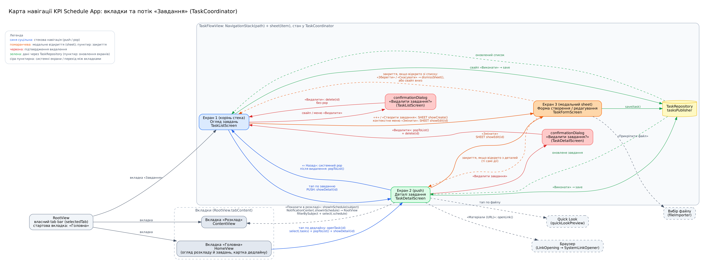

# KPI Schedule App

Мобільний iOS-застосунок для перегляду розкладу в КПІ. Дозволяє обирати групу й тиждень (1/2), переглядати пари, розрізняти їх за типами, бачити викладачів, аудиторії та час, фільтрувати пари, бачити виділені поточний день і поточну пару та переходити на онлайн-пари по кліку. Містить трекер завдань (предмети, дедлайни, матеріали, файли, прогрес) і вкладку «Головна» з оглядом розкладу та завдань.

- **Версія XCode:** 15.3
- **Мінімальна версія iOS:** 17.4
- **Теги для перевірки:** [`practical-1`](https://github.com/BronievM/KPI-IOS/releases/tag/practical-1), [`practical-2`](https://github.com/BronievM/KPI-IOS/releases/tag/practical-2), [`practical-3`](https://github.com/BronievM/KPI-IOS/releases/tag/practical-3), [`practical-4`](https://github.com/BronievM/KPI-IOS/releases/tag/practical-4)


## Практична робота 4: мережа та стани екрана (тег `practical-4`)

Розклад береться з реального API КПІ Campus. Власного сервера немає, тому завдання та лінки на пари кожен користувач редагує **локально** (Documents / UserDefaults).

### Опис API


| | |
|---|---|
| Базова адреса | `https://api.campus.kpi.ua` |
| Групи | `GET /schedule/groups` → масив `[{id, name, faculty}]` або `{"data": [...]}` |
| Розклад | `GET /schedule/lessons?groupId=<id>` → `{scheduleFirstWeek: [{day, pairs: [...]}], scheduleSecondWeek: [...]}` |
| Заголовки | `Accept: application/json`, таймаут 15 с |
| Авторизація | не потрібна |
| Модель | `CampusPair` (`name`, `time`, `type`, `lecturer.name`, `location.title`, `dates`) → `CampusScheduleMapper` → `LessonDTO` → `LessonDTOAdapter` → `Lesson` |

### Архітектура мережі

- `Services/Network/APIClient.swift`: єдине місце з `URLSession`; протокол `ScheduleAPIService`, `URLSession` передається ззовні. Розрізняє `transportError` (немає мережі, таймаут), `invalidHTTPStatus` (статус перевіряється **до** декодування) і `decodingError`.
- `RemoteScheduleRepository` отримує `ScheduleAPIService` через ініціалізатор і кешує відповіді на диску.
- `ScheduleViewModel` (стани `isLoading`, `refreshError`, `hasSchedule`) → `ContentView` / `HomeView`. Запити асинхронні (`async/await`), UI оновлюється на `@MainActor`.
- Екран розкладу: завантаження, дані, порожній результат, помилка з кнопкою **«Спробувати ще раз»**, pull-to-refresh. Якщо оновлення не вдалося, але є кеш, показується збережений розклад з банером «Повторити».

### Як перевірити стани

Реальний запит: звичайний запуск (потрібен інтернет). Керовані сценарії без залежності від API: Xcode → Product → Scheme → Edit Scheme → Run → Arguments Passed On Launch → додати `-api-mode <режим>`:

| Режим | Що відтворює |
|---|---|
| `success` | успішна відповідь із тестовими даними |
| `empty` | порожня відповідь → стан «Розклад порожній» |
| `offline` | транспортна помилка → екран помилки + «Спробувати ще раз» |
| `http500` | HTTP 500 |
| `badjson` | помилка декодування |
| `flaky` | перший запит падає, повтор по кнопці успішний |

У цих режимах використовується окремий тимчасовий кеш, справжні дані не чіпаються. Без аргументу застосунок працює з реальним API.

Автотести (`NetworkTests.swift`): URLProtocol-заглушка для `APIClient` (успіх, статус до декодування, зламаний JSON, транспортна помилка) і всі стани `ScheduleViewModel` через `MockScheduleAPIService`.

### «Спец. пари» (поле `dates`)

Якщо в парі з API є список `dates`, вона йде **лише в ці дати**, а не щотижня. Дати приводяться до `yyyy-MM-dd` (`LessonDates.normalize`), якщо формат не розпізнається - повертається формат без змін. На екрані розкладу пара показується тільки в день, що збігається з однією з дат вибраного тижня, з підписом «Спец. заняття · N з M» і наступними датами. «Головна» теж не пропонує таку пару в інші дні.

### Предмети у формі завдання

Список предметів береться з реального розкладу вибраної групи (кеш API), лише з тих, що обрано в «Мої предмети» (`SelectedGroupSubjectsProvider`). Якщо предмети ще не обирались, то показуються усі.

### Лінки на пари

Довгий тап по парі → «Додати / змінити лінк»; тап по парі без лінка відкриває редактор. Лінк діє на всі пари цього типу з предмета й зберігається на пристрої.


## Практична робота 3: навігація та переходи (тег `practical-3`)

Додано трекер завдань із кількома екранами та окремим шаром навігації (**Coordinator**). Три вкладки: **«Розклад»**, **«Головна»** (стартова), **«Завдання»**.

Сценарій «Завдання»: **Огляд завдань** → (push) **Деталі завдання** → (sheet) **Форма створення / редагування**; ще є діалог підтвердження видалення, вибір файлу, Quick Look і відкриття матеріалів у браузері. З деталей можна перейти на вкладку «Розклад» (фільтр за предметом), а з «Головної» відкрити деталі завдання.

Повна документація: **[docs/navigation.md](docs/navigation.md)**: карта навігації, таблиця переходів, Coordinator, стек проти sheet, передавання даних, стан інтерфейсу, анімації, цикли сильних посилань, інструкція проходження сценарію.



| Що | Де |
|---|---|
| Карта навігації | `docs/navigation-map.png`|
| Coordinator, маршрути, фабрика ViewModel | `Navigation/` (`TaskCoordinator`, `TaskRoute`, `TaskNavigating`, `TaskScreenFactory`) |
| Екрани | `Views/Tasks/` (`TaskFlowView`, `TaskListScreen`, `TaskDetailScreen`, `TaskFormScreen`) |
| Дані завдань | `Services/` (`TaskRepository`, `FileTaskRepository`, `InMemoryTaskRepository`) |

Коротко про навігацію: стан (`path: [TaskRoute]`, `sheet: TaskSheet?`) живе в `TaskCoordinator`; ViewModel лише «просять» перехід через протокол `TaskNavigating` (weak-посилання, без циклів); на наступний екран передається ідентифікатор завдання, а результат редагування повертається через `TaskRepository` і Combine-підписку (екрани оновлюються самі).

### Швидкий сценарій перевірки

1. Вкладка **«Завдання»**: тап по завданню відкриває деталі (push), «‹ Назад» повертає в список.
2. На деталях **«Змінити»** відкриває форму (sheet); «Зберегти» закриває її, деталі показують нові дані.
3. У списку **«+»** відкриває порожню форму; після збереження новий запис з'являється в огляді.
4. **«Виконати»** змінює вигляд кнопки (анімація) і прогрес у списку.
5. **«Показати в розкладі»** на деталях відкриває вкладку «Розклад» з фільтром за предметом.
6. Вкладка **«Головна»**: тап по дедлайну відкриває деталі цього завдання.

Докладніший покроковий сценарій: [docs/navigation.md](docs/navigation.md#10-інструкція-проходження-сценарію).

## Практична робота 2: архітектура та патерни (тег `practical-2`)

Застосунок переведено на **MVVM**, додано патерни Builder, Adapter, Strategy, розділено відповідальності та винесено залежності за протоколи (можна підмінити тестовою реалізацією).

Повна документація: **[docs/architecture.md](docs/architecture.md)** (обґрунтування архітектури, схема, патерни, SOLID, антипатерни, таблиця відповідності).

### Структура проєкту

```
kpi-schedule/
├── App/          kpi_scheduleApp, AppContainer (composition root)
├── Models/       Lesson, DailySchedule, LessonType, LessonTime, Weekday, ScheduleItem,
│                 StudyTask, TaskProgress, DeadlineInfo
├── Views/        RootView, ContentView, LessonRowView, HomeView, ScreenHeader
│   └── Tasks/    TaskFlowView, TaskListScreen, TaskDetailScreen, TaskFormScreen, ...
├── ViewModels/   ScheduleViewModel, HomeViewModel,
│                 TaskListViewModel, TaskDetailViewModel, TaskFormViewModel
├── Navigation/   TaskCoordinator, TaskRoute, TaskNavigating, TaskScreenFactory  (ЛР3)
├── Services/     ScheduleRepository, JSONScheduleRepository, MockScheduleRepository,
│                 TaskRepository, FileTaskRepository, InMemoryTaskRepository,
│                 SubjectsProviding, LinkOpening, ScheduleClock
└── Patterns/     LessonBuilder, LessonDTOAdapter, LessonFilterStrategy
kpi-scheduleTests/  ScheduleViewModelTests, TaskTests, TaskExtrasTests
kpi-scheduleUITests/  запуск і продуктивність
docs/               architecture.md, navigation.md, діаграми
```

### Коротко: патерн / принцип — компонент — призначення

| Патерн / принцип | Компонент | Призначення |
|---|---|---|
| MVVM | `ContentView` ↔ `ScheduleViewModel` ↔ `ScheduleRepository` | Розподіл обов'язків: інтерфейс лише показує дані, логіка обробляє стан, а сховище віддає інформацію. |
| Builder | `LessonBuilder` | Зручне створення складних об'єктів з купою необов'язкових параметрів по частинах. |
| Adapter | `LessonDTOAdapter` | Перетворює зовнішній формат даних на зручні внутрішні моделі застосунку. |
| Strategy | `LessonFilterStrategy` | Гнучке перемикання правил фільтрації без переписування коду екрана. |
| DIP + DI | `ScheduleViewModel`, `AppContainer` | Залежність від абстракцій (протоколів) і передача необхідних компонентів зовні через ініціалізатор. |
| Clock (DI) | `ScheduleClock` | Абстракція над поточним часом для коректного визначення пари й зручної підміни в тестах. |

Детальніше й повна таблиця (з SOLID) у [docs/architecture.md](docs/architecture.md).

## Практична робота 1 (тег `practical-1`)

Протоколи та enum (`ScheduleItem`, `LessonType`, `WeekType`), структури й класи (`Lesson` struct, `DailySchedule` class), опціонали (`room`, `link`) з безпечним розгортанням, колекції, інтерфейс на `NavigationView` + `List` з секціями по днях і клікабельними онлайн-парами.

## Інструкція з запуску

1. Клонуйте репозиторій і перейдіть на потрібний тег/гілку (`practical-3`).
2. Відкрийте `kpi-schedule.xcodeproj` у **Xcode 15.3**.
3. Оберіть симулятор (наприклад, iPhone 15) і натисніть **Run** (`Cmd + R`).
4. Тести: `Cmd + U`.