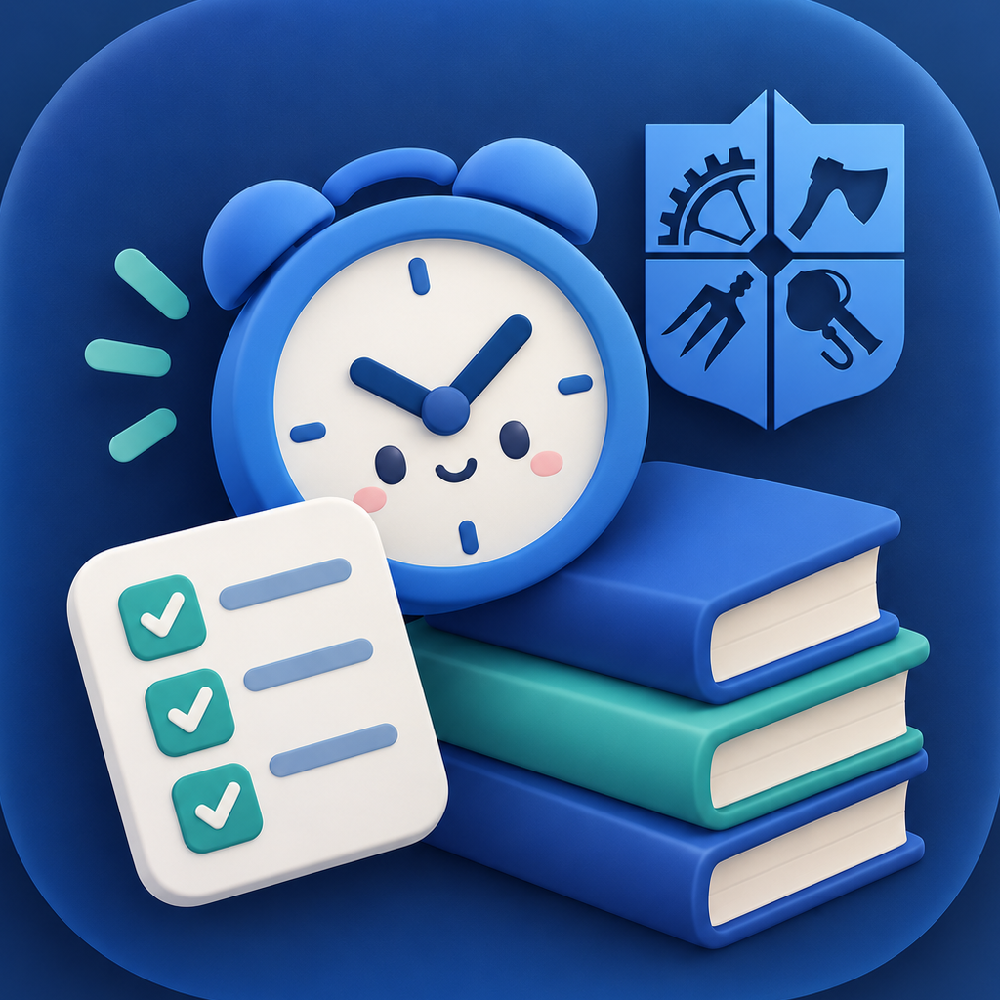

  

<h1 align="center">KPI Schedule</h1>
 

  iOS-застосунок для студентів КПІ: розклад, завдання та дедлайни в одному місці.

---
 
## Про застосунок
 
KPI Schedule показує розклад занять обраної групи з реального API КПІ Campus і допомагає не губити завдання. Застосунок відкривається на «Головній»: що зараз, що далі та які дедлайни наближаються.
 
## Можливості
 
- **Розклад** обраної групи на перший і другий тиждень, з виділенням поточного дня та поточної пари
- **Фільтри пар**: усі, за типом, лише онлайн
- **Мої предмети**: можна прибрати зайві предмети й вибіркові, які не відвідуєш
- **Лінки на пари**: додаєш посилання на онлайн-пару, і тап по ній відкриває його
- **Трекер завдань** з предметами, дедлайнами, матеріалами, файлами та прогресом
- **Головна**: огляд розкладу та найближчих дедлайнів
- **Робота з мережею**: кеш, повтор запиту, зрозумілі повідомлення про помилки

## Технології
 
Swift, SwiftUI, MVVM, Coordinator, `async/await`, `URLSession`. Xcode 15.3, iOS 17.4+.
 
## Запуск
 
1. Клонуйте репозиторій.
2. Відкрийте `kpi-schedule.xcodeproj` у Xcode 15.3.
3. Оберіть симулятор і натисніть **Run** (`Cmd + R`). Для завантаження розкладу потрібен інтернет.
4. Тести: `Cmd + U`.

## Документація
 
- [Архітектура](docs/architecture.md): MVVM, патерни, SOLID
- [Навігація](docs/navigation.md): карта переходів, Coordinator, сценарій перевірки
- [Мережа](docs/network.md): API КПІ Campus, обробка помилок, кеш, перевірка станів
- [Roadmap](ROADMAP.md): що зроблено, що в планах і що відкладено

## Лабораторні роботи
 
Реалізація й опис кожної практичної роботи лежать у відповідних гілках (`lab-1` … `lab-4`) і тегах.
 
| Практична | Тема | Гілка | Тег |
|---|---|---|---|
| 1 | Основи Swift, розклад | [`lab-1`](https://github.com/BronievM/KPI-IOS/tree/lab-1) | [`practical-1`](https://github.com/BronievM/KPI-IOS/releases/tag/practical-1) |
| 2 | Архітектура та патерни | [`lab-2`](https://github.com/BronievM/KPI-IOS/tree/lab-2) | [`practical-2`](https://github.com/BronievM/KPI-IOS/releases/tag/practical-2) |
| 3 | Навігація та переходи | [`lab-3`](https://github.com/BronievM/KPI-IOS/tree/lab-3) | [`practical-3`](https://github.com/BronievM/KPI-IOS/releases/tag/practical-3) |
| 4 | Мережа та стани екрана | [`lab-4`](https://github.com/BronievM/KPI-IOS/tree/lab-4) | [`practical-4`](https://github.com/BronievM/KPI-IOS/releases/tag/practical-4) |
 
## Плани
 
Поточні й майбутні задачі: [ROADMAP.md](ROADMAP.md)