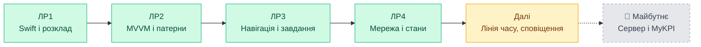
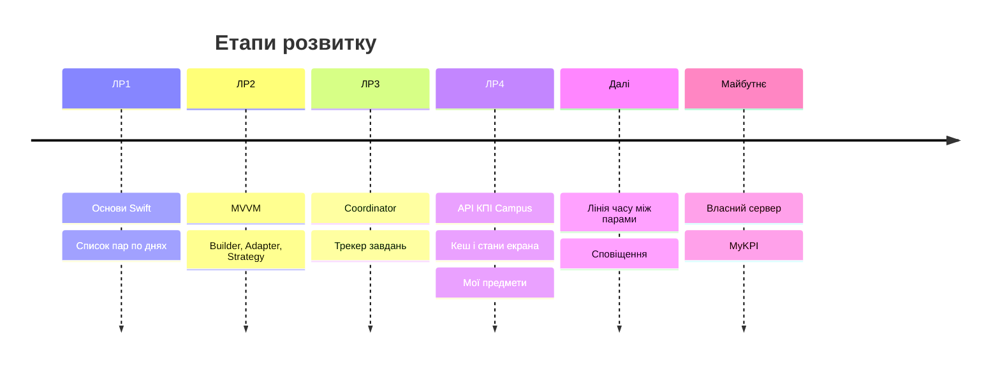

# Roadmap: KPI Schedule App

Легенда: `[x]` зроблено, `[ ]` заплановано, 🔮 відкладено на майбутнє (потребує сервера або авторизації в MyKPI)

## Загальний рух
 

 

 
---

## ЛР1: основи Swift і розклад

- [x] Протоколи та enum (`ScheduleItem`, `LessonType`, `WeekType`)
- [x] `Lesson` (struct) і `DailySchedule` (class)
- [x] Опціонали (`room`, `link`) з безпечним розгортанням
- [x] Список пар по днях (`NavigationView` + `List` із секціями)
- [x] Клікабельні онлайн-пари

## ЛР2: архітектура та патерни

- [x] Перехід на MVVM (`ContentView` ↔ `ScheduleViewModel` ↔ `ScheduleRepository`)
- [x] Builder (`LessonBuilder`)
- [x] Adapter (`LessonDTOAdapter`)
- [x] Strategy (`LessonFilterStrategy`: усі / за типом / онлайн)
- [x] DIP + DI через `init`, composition root в `AppContainer`
- [x] `ScheduleClock` для підміни часу в тестах
- [x] Підсвітка поточного дня та поточної пари
- [x] Юніт-тести ViewModel без UI та реального джерела даних
- [x] Документація: `docs/architecture.md`

## ЛР3: навігація та трекер завдань

- [x] Три вкладки: "Розклад", "Головна", "Завдання"
- [x] Coordinator (`TaskCoordinator`, `TaskRoute`, `TaskNavigating`, `TaskScreenFactory`)
- [x] Потік "Завдання": список → деталі (push) → форма (sheet)
- [x] Діалог видалення, вибір файлу, Quick Look, відкриття матеріалів у браузері
- [x] Перехід з деталей у "Розклад" з фільтром за предметом
- [x] Перехід з "Головної" на деталі завдання
- [x] Локальне сховище завдань (`FileTaskRepository`, `InMemoryTaskRepository`)
- [x] Локальне сховище файлів (`FileAttachmentStorage`, `AttachmentStoring`)
- [x] Документація: `docs/navigation.md`, карта навігації

## ЛР4: мережа та стани екрана

### Вимоги завдання

- [x] Джерело даних: API КПІ Campus (адреса, endpoint, параметри, формат, без авторизації) з описом у README
- [x] Окремий мережевий компонент: `APIClient` (єдине місце з `URLSession`)
- [x] Реальний асинхронний запит (групи та розклад) і `Decodable`: `CampusPair` → `CampusScheduleMapper`
- [x] Мережевий шар в архітектурі: протокол `ScheduleAPIService`, DI через `init`, оновлення UI на `@MainActor`
- [x] Стани екрана: завантаження, дані, порожній результат, помилка з кнопкою "Спробувати ще раз", pull-to-refresh
- [x] Розрізнення помилок: `transportError`, `invalidHTTPStatus` (перевіряється до декодування), `decodingError`
- [x] Інтерфейс не блокується під час очікування (`async/await`)
- [x] Керовані негативні сценарії: `-api-mode` (success / empty / offline / http500 / badjson / flaky)
- [x] Автотести мережі: `NetworkTests` (URLProtocol-заглушка, `MockScheduleAPIService`)
- [x] Commit, push, опис запуску й перевірки станів у README, тег `practical-4`
- [x] Кеш відповідей на диску й показ кешу з банером "Повторити" при помилці оновлення
- [x] Повтор запиту при обриві з'єднання (`-1005`), вимкнення HTTP/3, заголовки `Origin` / `Referer`
- [x] "Спец. пари" (поле `dates`)
- [x] Лінки на пари (довгий тап, зберігаються локально)
- [x] Вибіркові предмети: `Lesson.isElective`, `ElectiveStoring` / `LocalElectiveStore` (вибір на пристрої окремо для групи)
- [x] Екран "Мої предмети" (`ElectivesView`): "Вибрати всі" / "Зняти всі"
- [x] Фільтр розкладу та "Головної" за обраними предметами (`isSubjectEnabled`)
- [x] Предмети у формі завдання лише з обраних (`SelectedGroupSubjectsProvider`)
- [x] Пошук по списку груп (`.searchable`: назва групи або факультет)
- [x] Хаптик при відмітці завдання виконаним (`sensoryFeedback`)
- [x] Темна тема перевірена
- [x] Перехід на завдання з "Головної" повертає на "Головну", а зі вкладки "Завдання" повертає до завдань (`taskOrigin`)
- [x] Зробити прогрес завдань клікабельним (як розклад): тап відкриває відповідне завдання або список

#### Вибіркові предмети та прогрес

- [ ] Фільтр розкладу "Мої предмети"/"Усі предмети"

#### Розклад

- [ ] Лінія поточного часу в розкладі (зараз статична лінія з пульсуючою крапкою біля поточної пари): показувати послідовний прогрес між парами ("перша пара закінчилась", частка шляху до наступної, час до наступного предмета)
- [ ] Підпис "Оновлено N хв тому" біля розкладу (за часом збереження кешу)
- [ ] Скасування запиту, коли користувач швидко змінює групу

#### Сповіщення

- [ ] `LessonNotificationScheduler`: сповіщення про початок пари
- [ ] Сповіщення про дедлайни завдань
- [ ] `LiveActivityController`: Live Activity "пара зараз"

---

## 🔮 Майбутнє: власний сервер і MyKPI

Усе нижче потребує бекенда або авторизації, тому поки не є пріоритетним (додаток не планується публікувати в App Store, а інтеграція з MyKPI складна)

### Інтеграція з MyKPI

- [ ] 🔮 Авторизація в MyKPI
- [ ] 🔮 Точний список вибіркових предметів студента з MyKPI (зараз "Імовірно вибіркові" ґрунтуються на здогадці `markElectives`, а вибір робиться вручну)

### Ролі

- [ ] 🔮 Адмін / викладач: створює, редагує й видаляє завдання та предмети групи, бачить статистику виконання
- [ ] 🔮 Студент: бачить завдання групи, відмічає лише власне виконання
- [ ] 🔮 `CurrentUser` (роль) і перевірка прав у ViewModel ("+", "Змінити", "Видалити" лише для адміна)
- [ ] 🔮 Екран входу як окремий потік навігації (Coordinator входу)

### Модель даних на сервері

- [ ] 🔮 Таблиці: `users`, `groups`, `subjects` (`is_elective`), `tasks`, `completions`, `enrollments`, `task_attachments`
- [ ] 🔮 `isDone` переноситься із завдання в `completions` поточного користувача (`TaskCompletion`)
- [ ] 🔮 Вибір вибіркових переноситься з `LocalElectiveStore` у `enrollments` на сервері

### Зміни в застосунку

- [ ] 🔮 `RemoteTaskRepository` замість `FileTaskRepository` (підстановка в `AppContainer`)
- [ ] 🔮 `RemoteAttachmentStorage` замість `FileAttachmentStorage` (екрани не змінюються)
- [ ] 🔮 Спільні завдання групи замість локальних
- [ ] 🔮 Розклад і лінки на пари з власного API (за потреби)

> Завдяки протоколам (`TaskRepository`, `AttachmentStoring`, `SubjectsProviding`) перехід на сервер має зводитись до нових реалізацій і зміни в `AppContainer`, без переписування екранів, ViewModel і Coordinator.