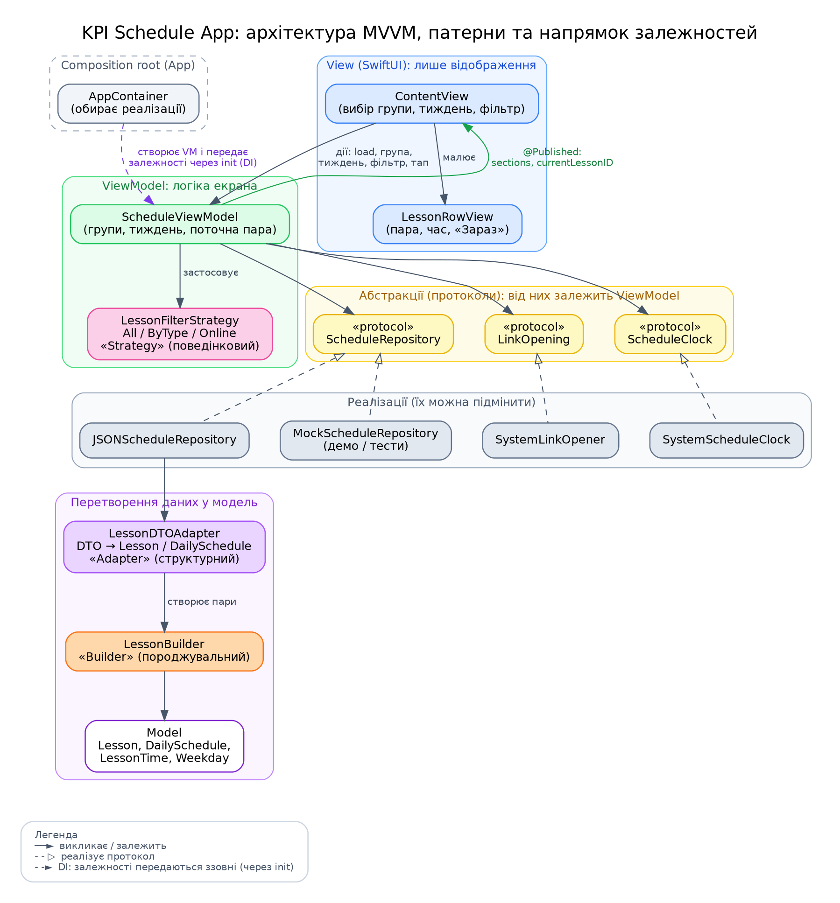

# Архітектура KPI Schedule App (практична 2)

## 1. Аналіз сценарію та розподіл відповідальності

Основний сценарій: **користувач відкриває застосунок, обирає групу та тиждень (1/2), бачить розклад із виділеними поточним днем і поточною парою, може відфільтрувати пари та відкрити посилання на онлайн-пару.**

| Шар | Відповідальність | Компоненти |
|---|---|---|
| Представлення | Відображення стану, передача дій користувача | `ContentView`, `LessonRowView` |
| Логіка | Стан екрана, фільтрація, обробка дій | `ScheduleViewModel`, `LessonFilterStrategy` |
| Доступ до даних | Отримання розкладу з джерела | `ScheduleRepository`, `JSONScheduleRepository`, `MockScheduleRepository`, `LessonDTOAdapter` |
| Модель | Доменні сутності | `Lesson`, `DailySchedule`, `LessonType`, `WeekType` |
| Системні сервіси | Взаємодія з ОС: відкриття посилань, поточний час | `LinkOpening`, `SystemLinkOpener`, `ScheduleClock`, `SystemScheduleClock` |

## 2. Обрана архітектура: MVVM

**Обґрунтування.**
- SwiftUI побудований на реактивному зв'язуванні (`@Published` / `ObservableObject`), що відповідає ролі ViewModel у MVVM.
- MVC у SwiftUI призводить до «Massive View»: логіка накопичується у View. У практичній 1 саме так і було (відкриття посилань і дані прямо у View/App).
- VIPER для застосунку з одним екраном і невеликою логікою надмірний (багато шаблонного коду без користі).
- ViewModel не залежить від UI, тому логіку можна тестувати без запуску інтерфейсу.

**Обмеження MVVM.**
- ViewModel може «розростатися», якщо складати в неї всю логіку (при зростанні проєкту її треба ділити на сервіси/use case).
- Немає окремого місця для навігації (для багатьох екранів потрібен Coordinator/Router).
- Потрібно стежити за узгодженістю стану (`@Published`), особливо при асинхронних даних.
- У цьому проєкті: репозиторій синхронний, `DailySchedule` — клас (reference type), тому потенційно спільний змінюваний стан. Для навчального обсягу це прийнятно.

### Схема компонентів




Напрямок залежностей: **View → ViewModel → (протоколи) ← реалізації сервісів**. Жоден шар вище не знає про конкретні реалізації нижче.

### Сценарій через компоненти

1. `kpi_scheduleApp` отримує `ScheduleViewModel` з `AppContainer` (вибір реалізацій зроблено тут).
2. `ContentView.onAppear` → `viewModel.load()`: ViewModel запитує список груп (`repository.fetchGroups()`) і обирає першу.
3. Для групи викликається `repository.fetchWeeklySchedule(for:)`. `JSONScheduleRepository` декодує JSON у `LessonDTO`, `LessonDTOAdapter` перетворює їх на `DailySchedule`/`Lesson` (через `LessonBuilder`), групує за днем і тижнем та сортує дні й пари за часом.
4. ViewModel бере з `ScheduleClock` поточний тиждень, день і час, обирає за замовчуванням поточний тиждень, лишає дні вибраного тижня, застосовує стратегію фільтрації й публікує `sections` (з прапорцем `isToday`) та `currentLessonID`.
5. `ContentView` перемальовується. Користувач може змінити групу, тиждень (1/2) або фільтр: ViewModel перебудовує `sections`. Таймер раз на 30 с викликає `refreshNow()`, і підсвітка «Сьогодні» / «Зараз» оновлюється.
6. Тап по парі → `viewModel.open(lesson)` → `LinkOpening.open(url)`.

## 3. Патерни проєктування

### Builder (породжувальний), `LessonBuilder`
- **Задача:** `Lesson` має багато опціональних полів (`room`, `isOnline`, `link`); довгий `init` з кількома необов'язковими параметрами важко читати та легко переплутати.
- **Учасники:** Builder: `LessonBuilder`; Product: `Lesson`; клієнти (Director): `LessonDTOAdapter`, `MockScheduleRepository`, тести.
- **Місце використання:** створення пар в Adapter, Mock-репозиторії та тестах (`LessonBuilder().subject(...).type(.lab).online(link:).build()`).

### Adapter (структурний), `LessonDTOAdapter`
- **Задача:** зовнішній формат даних (`LessonDTO`: рядкові типи, опціональні поля, пласкі записи) не збігається з доменними моделями; не можна змінювати моделі під формат джерела.
- **Учасники:** Adaptee: `LessonDTO`; Adapter: `LessonDTOAdapter`; Target: доменні `DailySchedule`/`Lesson`; Client: `JSONScheduleRepository`.
- **Місце використання:** `JSONScheduleRepository.fetchWeeklySchedule()`. Також розпізнає типи пар (`Lecture`/`Laboratory`/`Practical` та скорочення), тиждень (`first`/`second`) і час початку, групує записи за днем і тижнем, сортує дні та пари й пропускає записи з невідомим типом.

### Strategy (поведінковий), `LessonFilterStrategy`
- **Задача:** змінювати правило відбору пар (усі / за типом / лише онлайн) у рантаймі, не нагромаджуючи `if/switch` у ViewModel.
- **Учасники:** Strategy: `LessonFilterStrategy`; Concrete: `AllLessonsFilter`, `LessonTypeFilter`, `OnlineLessonsFilter`; Context: `ScheduleViewModel`; вибір стратегії: `FilterOption` (Picker у UI).
- **Місце використання:** `ScheduleViewModel.rebuildSections()`.

## 4. SOLID

- **S, Single Responsibility.** Кожен клас має одну причину для змін: `ContentView` лише відображає; `ScheduleViewModel` керує станом екрана; `JSONScheduleRepository` отримує дані; `LessonDTOAdapter` лише конвертує; `SystemLinkOpener` лише відкриває URL.
- **O, Open/Closed.** Новий спосіб фільтрації додається новою структурою, що реалізує `LessonFilterStrategy`; нове джерело даних додається новою реалізацією `ScheduleRepository`. Логіка ViewModel не змінюється. (Єдине місце, куди додається рядок, це `FilterOption`, точка вибору стратегії для UI.)
- **L, Liskov Substitution.** `JSONScheduleRepository` і `MockScheduleRepository` взаємозамінні для `ScheduleViewModel` без зміни його поведінки; усі стратегії повертають підмножину вхідних пар.
- **I, Interface Segregation.** Протоколи вузькі: `ScheduleRepository` (1 метод), `LinkOpening` (1 метод), `LessonFilterStrategy` (назва + 1 метод). ViewModel не залежить від зайвого.
- **D, Dependency Inversion.** `ScheduleViewModel` залежить від протоколів `ScheduleRepository`, `LinkOpening` і `ScheduleClock`, а не від конкретних класів (навіть час береться через протокол, а не через `Date()`). Реалізації обираються в `AppContainer`.

*Примітка.* Протокол `ScheduleItem` з практичної 1 залишено без змін; штучних ієрархій під нього не створювалося.

### Заміна реалізації без переписування компонента

Підмінити джерело даних достатньо в одному місці, `AppContainer`:
```swift
ScheduleViewModel(repository: MockScheduleRepository(), linkOpener: SystemLinkOpener())
```
У тестах підставляються `MockScheduleRepository(schedules:)`, `FailingRepository`, `SpyLinkOpener` та `FixedClock` (фіксований момент часу); `ScheduleViewModel` не змінюється.

### Dependency Injection vs Dependency Inversion
- **Dependency Inversion** це *принцип*: модулі високого рівня залежать від абстракцій, а не від конкретних реалізацій.
- **Dependency Injection** це *техніка*: залежності передаються ззовні (тут через `init`), а не створюються всередині класу.
- Вони не тотожні: можна робити DI, передаючи конкретний клас (без DIP), і можна дотримуватись DIP без DI (наприклад, через фабрику чи service locator). У проєкті використані обидва: протоколи (DIP) і передача через `init` (DI).

## 5. Перевірка на антипатерни

| Проблема (практична 1) | Виправлення |
|---|---|
| Надмірна відповідальність: моделі, логіка та `@main` в одному файлі | Моделі розділено по файлах у `Models/`, застосунок лише запускає `ContentView` |
| Пряме поєднання UI з даними: `createSchedule()` у `App`, дані зашиті в коді | Дані за `ScheduleRepository`; View отримує лише `sections` від ViewModel |
| Логіка у View: `openURL` і розбір посилання в `LessonRowView` | `LinkOpening` + `ScheduleViewModel.open(_:)`; View передає лише дію |
| Дублювання: вираз `room ?? (isOnline ? "Online" : "Unknown")` у двох методах | `getDetails()` використовує `getLocation()` |
| Приховані глобальні залежності | Відсутні: `UIApplication.shared` ізольовано в `SystemLinkOpener`, усі залежності передаються через `init` |

## 6. Тестування бізнес-логіки окремо від UI та реального джерела

`kpi-scheduleTests/ScheduleViewModelTests.swift` створює `ScheduleViewModel` з `MockScheduleRepository` (дані в пам'яті) і `SpyLinkOpener` (запам'ятовує відкриті URL), без SwiftUI та без JSON. Перевіряється: вибір групи, перемикання тижня, позначка поточного дня й пари (через `FixedClock`), фільтрація (Strategy), відкриття лише пар з посиланням, обробка помилки репозиторію, робота Adapter, Builder, `LessonTime` та `SystemScheduleClock`.

## 7. Відповідність «патерн / принцип — компонент — призначення»

| Патерн / принцип | Компонент | Призначення |
|---|---|---|
| MVVM | `ContentView`, `ScheduleViewModel`, `ScheduleRepository` | Розділення представлення, логіки та даних |
| Builder | `LessonBuilder` | Створення `Lesson` з опціональними полями |
| Adapter | `LessonDTOAdapter` | DTO → доменні моделі |
| Strategy | `LessonFilterStrategy`, `FilterOption` | Змінна фільтрація пар |
| SRP | View / ViewModel / Repository / Adapter / LinkOpener | Одна причина для змін на клас |
| OCP | `LessonFilterStrategy`, `ScheduleRepository` | Розширення без зміни ViewModel |
| LSP | `JSON`/`Mock` репозиторії | Взаємозамінність реалізацій |
| ISP | `ScheduleRepository`, `LinkOpening`, `LessonFilterStrategy` | Вузькі протоколи |
| DIP | `ScheduleViewModel` → протоколи | Залежність від абстракцій |
| DI | `AppContainer`, `init` ViewModel | Передача залежностей ззовні |
| DIP / DI (час) | `ScheduleClock`, `SystemScheduleClock` | Визначення поточного тижня, дня та пари; підміна часу в тестах |
