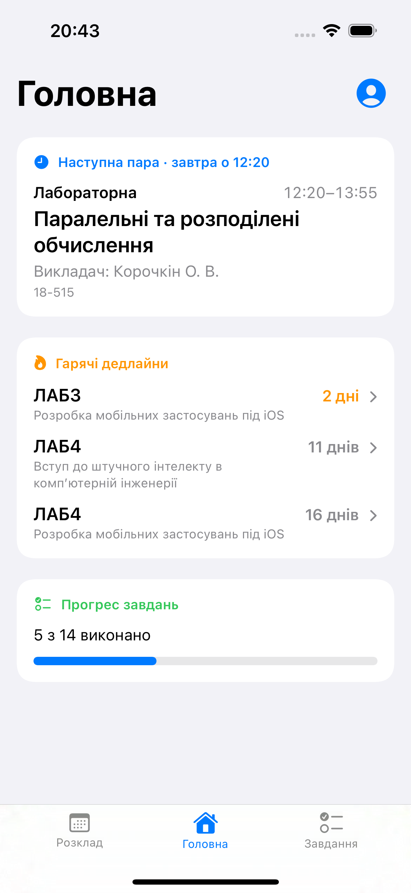
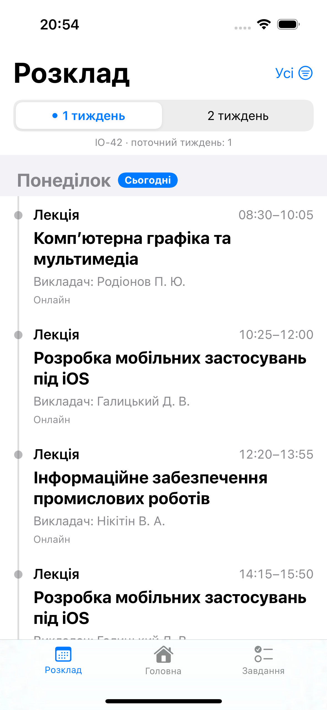
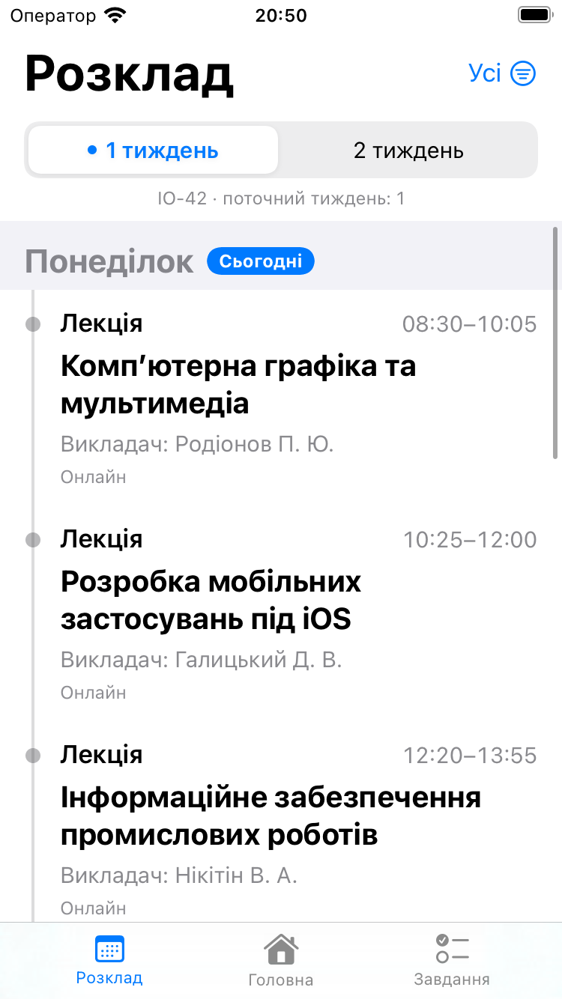
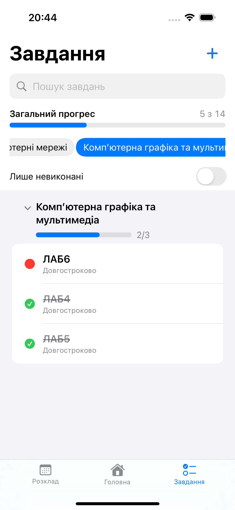
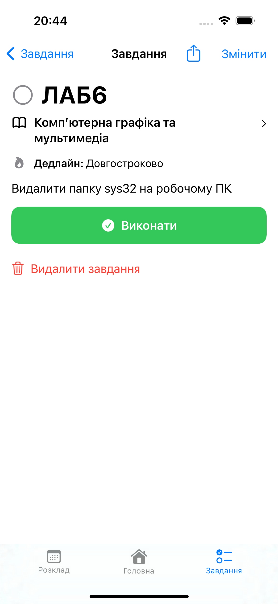
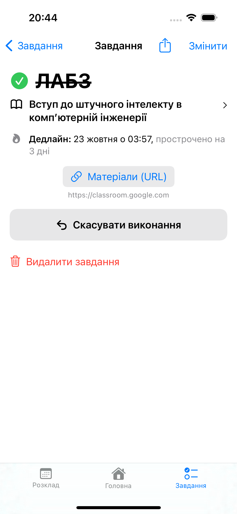
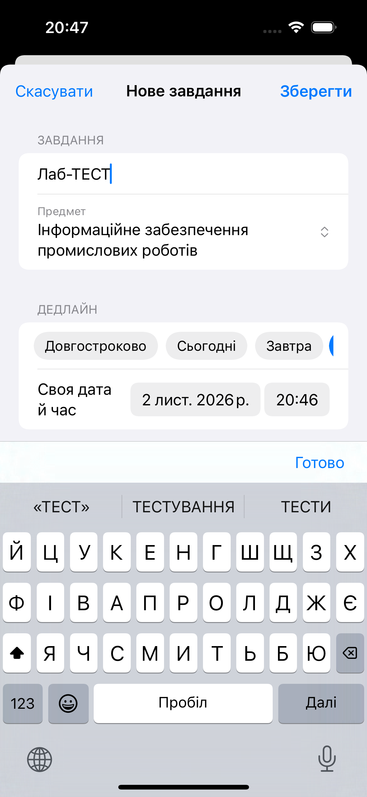
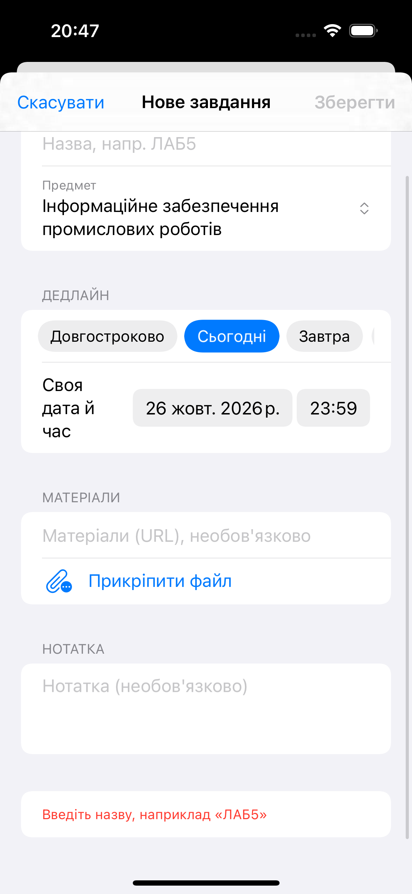
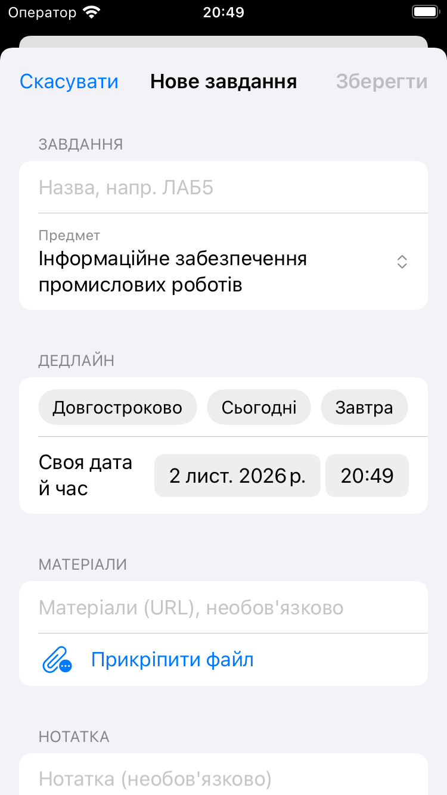
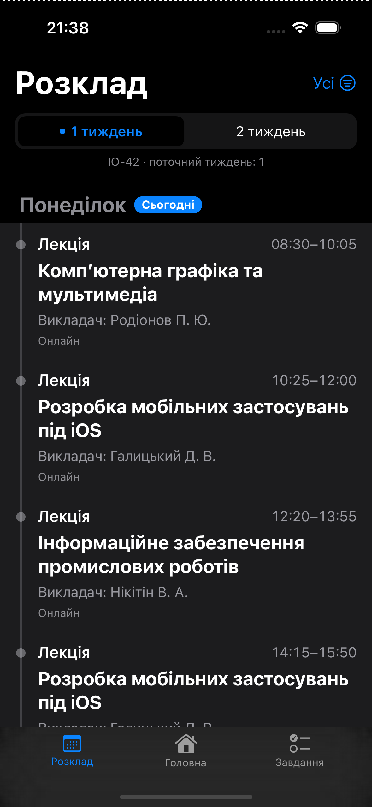

# Навігація та переходи (ЛР3)

## 1. Сценарій

Вкладка **«Завдання»** працює як трекер домашніх завдань, подібний до студентських ботів. Завдання належать **предмету** (наприклад, «ЛАБ5» з «Computer Networks»), мають дедлайн або позначку «Довгостроково», **«Матеріали (URL)»**, прикріплені файли й статус **виконання**.

Користувач відкриває вкладку, бачить **загальний прогрес** і прогрес по кожному предмету, фільтрує за предметом (повторний тап по предмету знімає фільтр), лише невиконані або пошуком, згортає секції, відкриває завдання, відкриває матеріали й файли та позначає виконання (з анімацією). Нове завдання створюється в модальній формі, де обирається предмет зі списку (з розкладу) або вводиться новий. Після збереження екрани оновлюються автоматично.

Застосунок має три вкладки (власний tab bar у `RootView`): **«Розклад»**, **«Головна»** (стартова) і **«Завдання»**. Головна об'єднує короткий огляд розкладу та завдань. З картки дедлайну можна відкрити деталі завдання (відбувається перехід на вкладку «Завдання» з push на екран деталей), а з деталей — перейти до розкладу цього предмета.

## 2. Карта навігації

| Екран | Файл | Роль | Як відкривається |
|---|---|---|---|
| 1. Огляд завдань | `Views/Tasks/TaskListScreen.swift` | Загальний прогрес, чіпи предметів, пошук, перемикач «Лише невиконані», секції предметів із прогресом, свайпи «Виконати» / «Видалити» | Вкладка «Завдання» (корінь потоку) |
| 2. Деталі завдання | `Views/Tasks/TaskDetailScreen.swift` | Предмет (перехід «Показати в розкладі»), дедлайн, «Матеріали (URL)», файли, нотатка, кнопка «Виконати», видалення й поширення | **Push** зі списку або з картки дедлайну на «Головній» |
| 3. Форма створення / редагування | `Views/Tasks/TaskFormScreen.swift` | Назва, предмет (вибір або новий), дедлайн, «Матеріали (URL)», прикріплення файлів, нотатка | **Sheet** зі списку («+» або контекстне меню «Змінити») чи з деталей («Змінити») |
| Діалог видалення | `confirmationDialog` у `TaskDetailScreen` і `TaskListScreen` (два окремі діалоги) | Підтвердження незворотної дії | У деталях: кнопка «Видалити завдання» (після підтвердження `popToList()` і видалення). У списку: свайп «Видалити» або контекстне меню (після підтвердження лише видалення, без pop) |
| Вибір файлу | системний `fileImporter` у `TaskFormScreen` | Додати файл до завдання | «Прикріпити файл» на екрані 3 |
| Перегляд файлу | Quick Look (`quickLookPreview`) у `TaskDetailScreen` | Відкрити прикріплений файл | Тап по файлу на екрані 2 |
| Браузер | `LinkOpening` → `SystemLinkOpener` | Відкриття матеріалів (URL) | «Матеріали (URL)» на екрані 2 |
| Вкладка «Розклад» | `Notification.Name.showInSchedule` → `RootView` | Показати розклад, відфільтрований за предметом завдання | Тап по предмету на екрані 2 (`TaskNavigating.showInSchedule`) |
| Деталі з головної | `RootView.openTask(_:)` → `TaskCoordinator` | Відкрити вибране завдання з картки дедлайну | Тап по дедлайну на вкладці «Головна» |

Карта показує всі переходи потоку «Завдання», вкладки застосунку, системні екрани (Quick Look, вибір файлу, браузер) і обмін даними через `TaskRepository`.

### Таблиця переходів

| Звідки | Куди | Тип | Дія коду |
|---|---|---|---|
| Екран 1 | Екран 2 | push | тап по завданню → `showDetail(id)` (повторний тап ігнорується) |
| Екран 2 | Екран 1 | pop | кнопка «‹ Назад» (системна, без виклику Coordinator) або після видалення `popToList()` |
| Екран 1 | Екран 3 | sheet | «+» / «Створити завдання» → `showCreate()`; контекстне меню «Змінити» → `showEdit(id)` |
| Екран 2 | Екран 3 | sheet | «Змінити» → `showEdit(id)` |
| Екран 3 | Екран 1 або 2 | закриття sheet | «Зберегти» / «Скасувати» → `dismissSheet()`; свайп вниз (стан `sheet` скидається біндінгом) |
| «Головна» | Екран 2 | перемикання вкладки + push | `openTask(id)` у `RootView`: `popToList()`, `showDetail(id)`, `select(.tasks)` |
| Екран 2 | вкладка «Розклад» | перемикання вкладки | `showInSchedule(subject:)` → `NotificationCenter` → `RootView` (`filterBySubject`, `select(.schedule)`) |

## 3. Модель даних

`StudyTask`: назва (`ЛАБ5`), **предмет**, дедлайн (необов'язковий), «Матеріали (URL)», нотатка, **файли** (`[TaskAttachment]`), стан «виконано». Допоміжні типи: `TaskProgress` (виконано з усіх), `DeadlineInfo` (текст і терміновість дедлайну: «24 дні», «завтра», «прострочено на 2 дні», «Довгостроково»).

Предмети для вибору в формі постачає `SubjectsProviding` (реалізація `ScheduleSubjectsProvider` бере їх із розкладу) плюс предмети, які вже є в завданнях. `SubjectsProviding.electiveSubjects()` повертає вибіркові предмети.

Самі файли вкладень не лежать у JSON: `AttachmentStoring` (`FileAttachmentStorage`) зберігає їх у `Documents/Attachments/<id завдання>/<id файлу>/<назва>`, а в моделі лишається лише `TaskAttachment` (id і назва). Під час видалення завдання папка видаляється; якщо форму закрито без збереження, додані файли прибираються. Старі `tasks.json` без поля `attachments` читаються (власний декодер).

## 4. Хто за що відповідає

| Компонент | Відповідальність |
|---|---|
| `TaskCoordinator` | Єдине місце, де живе **стан навігації**: стек `path: [TaskRoute]` і модальний екран `sheet: TaskSheet?`. Виконує переходи (`showDetail`, `showCreate`, `showEdit`, `showInSchedule`, `dismissSheet`, `popToList`), створює ViewModel екранів через фабрику, захищає від подвійного тапу. |
| `TaskNavigating` (протокол) | Те, що ViewModel може «попросити» в навігації. ViewModel не знає про `NavigationStack` і `sheet`. |
| `TaskScreenFactory` | Створює ViewModel із залежностями (DI): репозиторій, предмети, відкриття посилань, вкладення та постачальник поточної дати. |
| ViewModel (`TaskListViewModel`, `TaskDetailViewModel`, `TaskFormViewModel`) | Логіка екрана й стан (групування за предметами, прогрес, фільтри, валідація); навігаційні дії делегуються через `TaskNavigating`. |
| Views | Лише відображення; дії передають у ViewModel. |
| `TaskRepository` | Джерело даних і сповіщення про зміни (`tasksPublisher`). |

Чому саме Coordinator: у SwiftUI навігація задається станом (`NavigationStack(path:)`, `.sheet(item:)`). Винесення стану в `TaskCoordinator` централізує переходи; його поведінку перевіряє `TaskCoordinatorTests` у `kpi-scheduleTests/TaskTests.swift`. Архітектурно це розвиток MVVM із практики 2: до шарів View → ViewModel → Repository додано шар навігації.

## 5. Стекова навігація та модальне відкриття

- **Стекова (push)**: екран «вглиб» ієрархії, тримається в `NavigationStack`, є кнопка «Назад» і жест від краю. Тут: огляд → деталі. Користувач розуміє, що це продовження того самого контексту.
- **Модальна (sheet)**: окреме тимчасове завдання поверх екрана (створити/змінити), яке треба завершити або скасувати; екран під ним лишається живим. Тут: форма. Закривається кнопками «Зберегти» / «Скасувати» (`dismissSheet()`) або свайпом вниз (SwiftUI сам скидає `coordinator.sheet` через біндінг `.sheet(item:)`).

Форма редагування відкривається з деталей, але `sheet` прив'язаний до `TaskFlowView` (кореня потоку), а не до `TaskDetailScreen`, тож стан модального екрана теж належить Coordinator.

## 6. Передавання даних і повернення результату

- **Вперед:** на екран деталей передається лише **ідентифікатор** (`TaskRoute.detail(UUID)`), актуальні дані ViewModel бере з репозиторію. Для форми: `TaskSheet.edit(UUID)`, форма заповнюється з репозиторію; `.create` відкриває порожню.
- **Назад:** форма не повертає результат через замикання, а зберігає завдання в `TaskRepository.save(_:)` і закривається. Репозиторій публікує новий список (`tasksPublisher`, Combine), і **огляд та деталі підписані на нього**, тому оновлюються самі (в тому числі, коли форму закрито, а під нею лежить екран деталей). Так екрани не залежать один від одного.

## 7. Стан інтерфейсу

| Стан | Де зберігається |
|---|---|
| Стек екранів, відкрита форма | `TaskCoordinator` (`@Published path`, `sheet`) |
| Дані екрана (секції, прогрес, завдання) | ViewModel (`@Published`), підписані на репозиторій |
| Фільтри (предмет, «лише невиконані», пошук) | `TaskListViewModel` |
| Згорнуті секції предметів, завдання для підтвердження видалення | `@State` у `TaskListScreen` (суто візуальний стан) |
| Файл у Quick Look | `TaskDetailViewModel.previewURL` |
| Поля форми | `TaskFormViewModel` (`@Published`) |
| Фокус клавіатури | `@FocusState` у `TaskFormScreen` |
| Самі завдання | `FileTaskRepository` → `tasks.json` у Documents (переживає перезапуск) |

ViewModel деталей і форми створюється через `@StateObject` з `@autoclosure`, тож один раз на екран, а не при кожному перемальовуванні батьківського View. ViewModel огляду — lazy-властивість Coordinator, тому під час переходів вперед і назад не перестворюється, а його фільтри зберігаються.

Загальний прогрес не залежить від фільтрів; прогрес предмета теж рахується за всіма його завданнями, навіть коли показано лише невиконані.

## 8. Анімації

1. **Загальний прогрес і прогрес предметів** (`ProgressBarView`): смуга плавно змінюється (spring), коли завдання виконується.
2. **Кнопка «Виконати»** в деталях завдання: змінює колір, текст і іконку («Виконати» ↔ «Скасувати виконання»).
3. **Червона/зелена позначка** завдання в списку підстрибує при зміні стану, а секції плавно переупорядковуються.
4. **Форма:** підказка валідації та поле дедлайну з'являються плавно; доданий файл з'являється, прибраний зникає.
5. **Огляд (екран 1):** лічильники «5 з 7» / «5/7» змінюються анімовано (`numericText`), чіп вибраного предмета плавно змінює колір і трохи збільшується, секції згортаються з поворотом шеврона, рядки при цьому з'являються/зникають, іконка стану в рядку змінюється (`symbolEffect(.replace)`), при 100% з'являється напис «Усе виконано!», порожній стан пульсує, зміна кількості виконаних дає легкий haptic.
6. **Зворотний зв'язок:** на екрані деталей зміна стану на «виконано» дає тактильний відгук; у списку відгук прив'язаний до зміни загальної кількості виконаних завдань.

Анімації інтерфейсу завдань прив'язані до **стану** (`isDone`, прогрес, `validationMessage`, `hasDeadline`, вибраний предмет, згорнутість секції), а не до самого переходу між екранами.

**Зменшення руху.** `TaskListScreen`, `FilterChip` та `TaskDetailScreen` враховують `accessibilityReduceMotion`. У `TaskFormScreen` частина анімацій задана без перевірки цього параметра, тому твердження, що режим вимикає всі власні анімації застосунку, було б неточним. Анімації не блокують взаємодію через окреме вимкнення hit testing; конкретну плавність і доступність варто перевіряти на пристрої.

## 9. Цикли сильних посилань

Ризик: ViewModel тримає навігатора, а навігатор тримає ViewModel; або замикання захоплює `self`.

Як уникнуто:
- `TaskCoordinator` → `listViewModel` **strong**, а ViewModel → `navigator` **weak** (`private weak var navigator: TaskNavigating?`; тому протокол `AnyObject`).
- ViewModel деталей і форми належать View (`@StateObject`), а не Coordinator.
- Підписки Combine: `sink { [weak self] … }`.
- Фабрика не зберігає ViewModel.

Якби `navigator` був сильним посиланням, пара Coordinator ⇄ ViewModel ніколи не звільнилася б.

## 10. Інструкція проходження сценарію

1. Відкрийте вкладку **«Завдання»**: угорі «Загальний прогрес», нижче чіпи предметів і секції завдань із прогресом («1/3»).
2. Натисніть чіп предмета, лишаться завдання лише цього предмета; загальний прогрес не змінюється. Натисніть той самий чіп ще раз: знову показано «усе». Увімкніть **«Лише невиконані»**, спробуйте пошук і згортання секції (тап по заголовку предмета).
3. Тапніть завдання: відкриється екран деталей (push) з дедлайном і відліком.
4. Натисніть **«Матеріали (URL)»** (відкриється браузер), відкрийте прикріплений файл (Quick Look), потім **«Виконати»**: кнопка змінює вигляд, а після повернення прогрес у списку збільшився.
5. Натисніть **«Змінити»**: відкриється модальна форма. Змініть назву, збережіть: деталі показують нову назву.
6. Поверніться кнопкою **«‹ Назад»**, а потім натисніть **«+»**: порожня форма. Спробуйте зберегти без назви (кнопка неактивна, підказка пояснює чому). Оберіть предмет у списку або «Новий предмет…», вимкніть «Є дедлайн» (буде «Довгостроково»), введіть «Матеріали (URL)», **прикріпіть файл** і введіть нотатку (клавіатура не закриває поля, «Готово» ховає її). Збережіть.
7. Свайпом вправо по рядку списку швидко відмітьте «Виконати», свайпом вліво видаліть (з підтвердженням).
8. На деталях натисніть **«Видалити завдання»** та підтвердіть: повернення до огляду.
9. Закрийте й відкрийте застосунок: завдання збереглися.

## 11. Перевірка інтерфейсу

Перевірено у симуляторі на IPhone SE (3rd gen) і IPhone 15 Pro Max

- [X] Огляд: чіпи прокручуються, довгі назви предметів не ламають заголовки секцій, текст не перекривається (SE і 15 Pro Max)
- [X] Деталі: довга назва, посилання та нотатка переносяться, кнопки доступні
- [X] Форма: клавіатура не закриває поле «Нотатка», до нього можна прокрутити; «Готово» ховає клавіатуру
- [X] Збільшений шрифт (Dynamic Type): макет не ламається
- [X] Повторні переходи: огляд → деталі → назад → деталі → форма → зберегти → назад (кілька разів) працюють без дублювання екранів
- [X] Подвійний тап по завданню відкриває деталі один раз
- [X] Свайп вниз по формі закриває її без втрати даних на екрані під нею
- [X] Екрани списку й деталей враховують «Зменшення руху»
- [X] Світла й темна теми
- [X] Додавання й видалення файлу у формі; «Скасувати» не лишає доданих файлів; видалення завдання прибирає файли
- [X] Усі системні елементи (пошук, вибір файлу, дати) українською

## 12. Скриншоти
 
Скриншоти знаходяться в папці `docs/screenshots`.
 

<table>
<tr>
  <td align="center"> <code>01-overview.png</code> Огляд: загальний прогрес, предмети, секції</td>
  <td align="center"> <code>02-schedule.png</code> Вигляд розкладу</td>
  <td align="center"> <code>03-iphone-se-sc.png</code> Розклад на малому екрані</td>
</tr>
<tr>
  <td align="center"> <code>04-filter.png</code> Фільтр за предметом / лише невиконані</td>
  <td align="center"> <code>05-detail.png</code> Деталі невиконаного завдання</td>
  <td align="center"> <code>06-detail-done.png</code> Деталі виконаного завдання</td>
</tr>
<tr>
  <td align="center"> <code>07-form-create.png</code> Форма створення з клавіатурою</td>
  <td align="center"> <code>08-form-validation.png</code> Підказка валідації</td>
  <td align="center"> <code>09-iphone-se-form.png</code> Огляд / форма на малому екрані</td>
</tr>
<tr>
  <td align="center" colspan="3"> <code>10-darkmode.png</code> Темна тема</td>
</tr>
</table>

## 13. Відповідність «патерн / принцип — компонент — призначення» (доповнення до практики 2)

| Патерн / принцип | Компонент | Призначення |
|---|---|---|
| Coordinator | `TaskCoordinator`, `TaskNavigating` | Керування стеком і модальними екранами, окремо від View та ViewModel |
| Factory | `TaskScreenFactory` | Створення ViewModel із залежностями (DI) |
| Observer | `TaskRepository.tasksPublisher` (Combine) | Автоматичне оновлення огляду й деталей після змін |
| Repository + обгортка (Decorator-подібна) | `TaskRepository`, `InMemoryTaskRepository`, `FileTaskRepository` | Зберігання за протоколом; файлова реалізація додає запис на диск до in-memory |
| DIP / DI | ViewModel → `TaskRepository`, `TaskNavigating`, `SubjectsProviding`, `LinkOpening` | Залежність від абстракцій; підміна на тестову реалізацію |
| SRP | View / ViewModel / Coordinator / Repository | Одна причина для змін на компонент |

## 14. Перевірка логіки без UI

Unit-тести розділені за файлами:

- `kpi-scheduleTests/ScheduleViewModelTests.swift` перевіряє завантаження груп і розкладу, тижні, поточний день і пару, фільтри, посилання та помилки репозиторію.
- `kpi-scheduleTests/TaskTests.swift` перевіряє модель і дедлайни, репозиторії, постачальник предметів, ViewModel списку / деталей / форми та `TaskCoordinator`.
- `kpi-scheduleTests/TaskExtrasTests.swift` перевіряє сумісність зі старим JSON, фільтри й пошук, вибіркові предмети, пресети дедлайнів, очищення файлів форми та обчислення стану пари на «Головній».

Тести використовують in-memory/mock залежності, фіксований час і spy для навігації та відкриття посилань. UI-тести розташовані в `kpi-scheduleUITests/` і містять перевірки запуску та продуктивності.

## 15. Посилання на тег

- Тег: [`practical-3`](https://github.com/BronievM/KPI-IOS/releases/tag/practical-3)